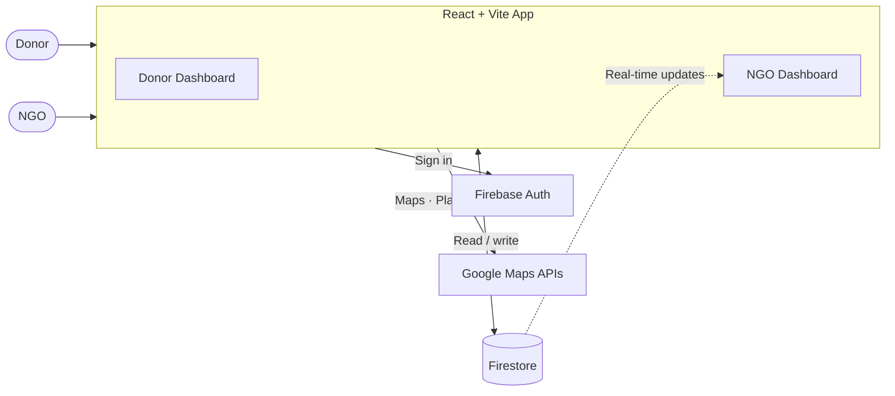
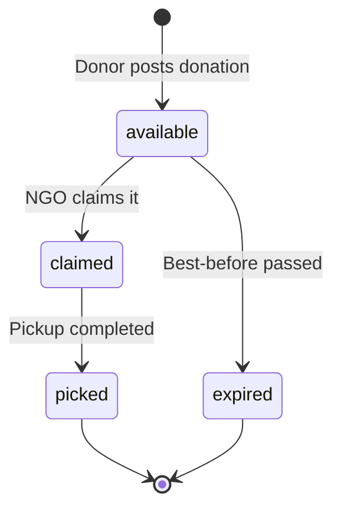

<div align="center">

# Left2Lift

**Connecting food donors and NGOs to reduce food waste and power last-mile redistribution.**


</div>

---

## Overview

Left2Lift is a role-based web app that helps surplus food reach people who need it. Donors post available food, and nearby NGOs discover it on a live map, claim it, and plan an optimized pickup route.

| Role | Who | What they do |
|------|-----|--------------|
| **Donor** | Restaurants, events, caterers | Post surplus food with location and pickup details |
| **NGO** | Non-profit organizations | Find nearby donations, claim them, and navigate to pickups |

---

## Features

| Area | Highlights |
|------|------------|
| **Authentication** | Email and password login with Firebase Auth, role chosen at signup, role-based routing (`/donor`, `/ngo`) |
| **Donors** | Post donations (title, description, quantity, food type, best-before time, pickup window), Google Places address autocomplete, geolocation fallback, live status cards (Total, Available, Claimed, Completed) |
| **NGOs** | Real-time donation feed, map and list views, filters (All Available, Available Now, Claimed, Mine), one-click claim, notifications for new donations |
| **Routing** | Quick route in Google Maps, multi-pickup route planner with optimized waypoints, ETA, distance, and step-by-step progress |
| **UI** | Responsive dashboards, color-coded status badges, modal flows, Tailwind CSS with Lucide icons |

---

## How It Works



### Donation Lifecycle



1. A donor signs in and posts a donation, which is saved to Firestore as `available`.
2. Every NGO dashboard receives the update in real time.
3. An NGO claims the donation, which becomes `claimed`.
4. The NGO follows the in-app route to the pickup.
5. Once collected, the donation is marked `picked`.

---

## Tech Stack

| Layer | Technology |
|-------|------------|
| **Frontend** | React 18, TypeScript |
| **Build tool** | Vite 5 |
| **Routing** | React Router 7 |
| **Styling** | Tailwind CSS, Lucide React |
| **Auth** | Firebase Authentication |
| **Database** | Cloud Firestore (real-time) |
| **Storage** | Firebase Storage |
| **Maps** | Google Maps JS API (Maps, Places, Directions, Geometry) |

---

## Getting Started

### Prerequisites

- Node.js 18 or later and npm 9 or later
- A [Firebase project](https://console.firebase.google.com/)
- A [Google Cloud project](https://console.cloud.google.com/) with the Maps APIs enabled

### 1. Clone and install

```bash
git clone https://github.com/Tejas164321/Left2Lift.git
cd Left2Lift
npm install
```

### 2. Configure environment

```bash
cp .env.example .env
```

Fill in `.env` with your keys:

```env
# Firebase
VITE_FIREBASE_API_KEY=your_firebase_api_key
VITE_FIREBASE_AUTH_DOMAIN=your-project-id.firebaseapp.com
VITE_FIREBASE_PROJECT_ID=your-project-id
VITE_FIREBASE_STORAGE_BUCKET=your-project-id.appspot.com
VITE_FIREBASE_MESSAGING_SENDER_ID=your_sender_id
VITE_FIREBASE_APP_ID=your_app_id

# Google Maps
VITE_GOOGLE_MAPS_API_KEY=your_google_maps_api_key
```

| Variable | Where to find it |
|----------|------------------|
| `VITE_FIREBASE_*` | Firebase Console → Project Settings → Your Apps → Web SDK config |
| `VITE_GOOGLE_MAPS_API_KEY` | Google Cloud Console → APIs & Services → Credentials |

Enable these APIs in your Google Cloud project: **Maps JavaScript API**, **Places API**, and **Directions API**.

### 3. Run

```bash
npm run dev
```

Open [http://localhost:5173](http://localhost:5173).

### Scripts

| Command | Description |
|---------|-------------|
| `npm run dev` | Start the development server |
| `npm run build` | Build for production into `dist/` |
| `npm run preview` | Preview the production build |
| `npm run lint` | Run ESLint |

---

## Project Structure

```
Left2Lift/
├── public/
├── src/
│   ├── components/
│   │   ├── Auth/            # Login, signup, role selection
│   │   ├── Donor/           # Dashboard and post-donation forms
│   │   ├── NGO/             # Feed, map view, route planner
│   │   └── Layout/          # Layout wrappers and navbar
│   ├── config/
│   │   └── firebase.ts      # Firebase initialization
│   ├── hooks/
│   │   ├── useAuth.ts       # Auth state and roles
│   │   └── useGoogleMaps.ts # Maps API loader
│   ├── types/
│   │   └── index.ts         # Shared interfaces
│   └── App.tsx              # Root component and routes
├── .env.example             # Environment template
├── tailwind.config.ts
├── vite.config.ts
└── package.json
```

---

## Data Model

### `users`

| Field | Type | Description |
|-------|------|-------------|
| `email` | `string` | Email address |
| `displayName` | `string` | Display name |
| `role` | `"donor" \| "ngo"` | Role chosen at signup |
| `createdAt` | `timestamp` | Account creation time |

### `donations`

| Field | Type | Description |
|-------|------|-------------|
| `donorId`, `donorName` | `string` | Donor UID and display name |
| `title`, `description` | `string` | What is being donated |
| `quantity` | `string` | Amount or portions |
| `foodType` | `string` | Category, for example cooked or packaged |
| `expiryTime` | `timestamp` | Best-before time |
| `pickupWindow` | `string` | Available pickup time range |
| `location` | `{ lat, lng, address }` | Coordinates and readable address |
| `status` | `"available" \| "claimed" \| "picked" \| "expired"` | Current status |
| `claimedBy`, `claimedByName` | `string?` | NGO UID and name, set when claimed |
| `claimedAt` | `timestamp?` | When it was claimed |
| `createdAt` | `timestamp` | When it was posted |

> **Firestore indexes:** Dashboard queries that combine `where` and `orderBy` may need composite indexes. If one is missing, Firestore logs a direct link in the browser console to create it.

---

## Production Checklist

- Set **Firestore Security Rules** to restrict reads and writes by user role.
- Restrict your **Google Maps API key** by HTTP referrer.
- Keep `.env` out of version control.

---

## Contributing

Contributions and feature requests are welcome.

1. Fork the repository
2. Create a branch: `git checkout -b feature/your-feature-name`
3. Commit your changes: `git commit -m "feat: describe your change"`
4. Push and open a pull request

---

## License

Released under the [MIT License](./LICENSE).

---

<div align="center">

Made with ❤️ to reduce food waste, one pickup at a time.

</div>
